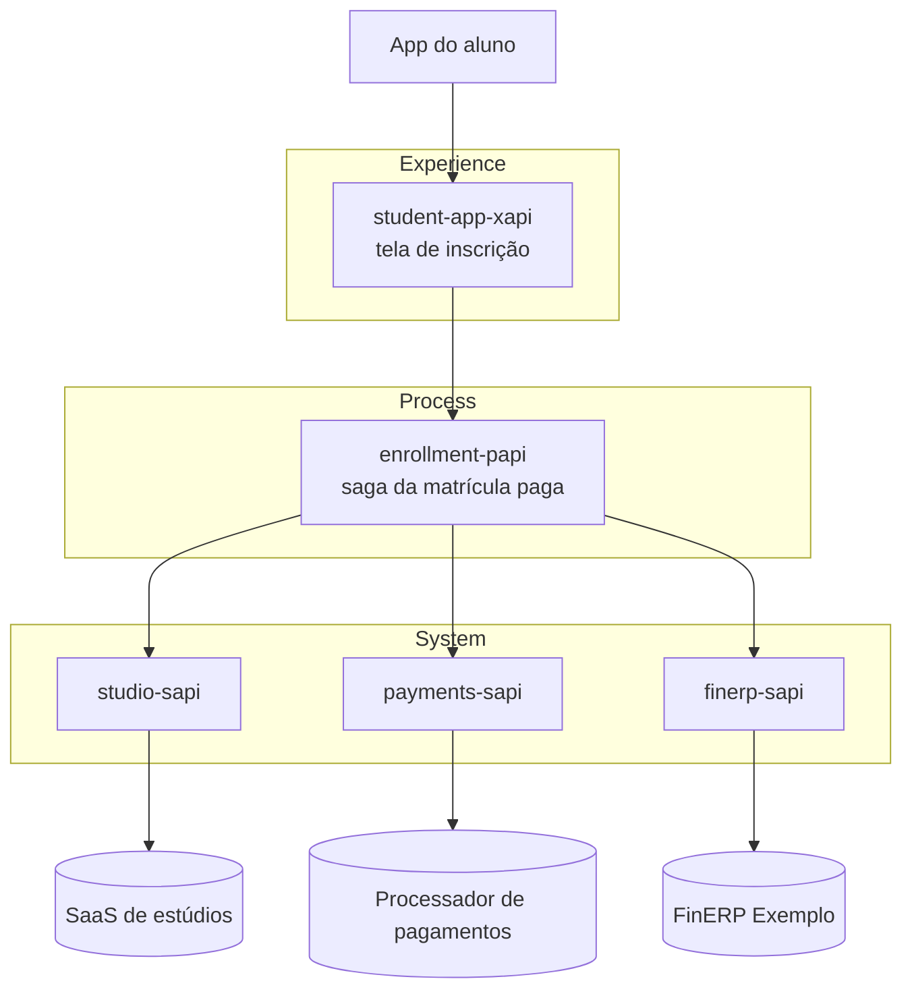

# mule-api-led


Arquitetura API-Led Connectivity em Mule 4 e DataWeave que permite a um aluno se matricular e pagar uma aula pelo app, integrando um SaaS de estúdios, um processador de pagamentos e um ERP financeiro legado. Todos os sistemas e dados são fictícios.

## O problema

Uma rede de estúdios de yoga e pilates matricula alunos no balcão: a recepção confere a vaga no SaaS de estúdios, cobra na maquininha e lança o título no ERP (o "FinERP Exemplo") no fim do dia. O app do aluno precisa fazer isso sozinho, numa chamada, com três garantias:

- **ninguém é cobrado duas vezes**, mesmo com timeout e reenvio;
- **ninguém paga sem vaga**, e vaga abandonada não fica presa;
- **o ERP fora do ar não impede a matrícula**: o título entra depois.

E o próximo canal (site, balcão digital) não pode exigir reescrever tudo.

## Arquitetura

Cinco aplicações Mule independentes em três camadas. Dependências só descem. O porquê das camadas, o reuso e a governança estão em [docs/api-led.md](docs/api-led.md).



| Aplicação | Camada | Porta local | O que faz |
| --- | --- | --- | --- |
| `student-app-xapi` | Experience | 8081 | traduz pedido e resposta para a tela do app (`R$ 150,00`, mensagens prontas) |
| `enrollment-papi` | Process | 8082 | elegibilidade, reserva, cobrança, confirmação, título no ERP, compensações |
| `studio-sapi` | System | 8083 | alunos, aulas e reservas no modelo canônico |
| `finerp-sapi` | System | 8084 | títulos a receber, escondendo o layout legado do ERP |
| `payments-sapi` | System | 8085 | cobranças em centavos com `Idempotency-Key` |

Cada aplicação tem: spec OAS 3.0 com APIkit, `pom.xml` com mule-maven-plugin (POM pai com versões centralizadas), flows XML, transformações em `.dwl`, configuração por ambiente (`local`, `mocks`, `dev`, `prod`) com propriedades seguras, handler de erro global (On Error Continue para 4xx, On Error Propagate para 5xx), retry com `until-successful` e correlação por `X-Correlation-ID`.

```
apps/<app>/
  pom.xml, mule-artifact.json
  src/main/mule/                 global.xml, global-error-handler.xml, <app>.xml, *-backend.xml | *-client.xml
  src/main/resources/api/        spec OAS
  src/main/resources/dw/         transformações DataWeave
  src/main/resources/modules/    funções DataWeave (catálogo de erros, formatação)
  src/main/resources/config/     common.yaml, <env>.yaml, secure-<env>.yaml
  src/test/munit/                suítes MUnit
  src/test/resources/fixtures/   payloads fictícios (MUnit, mocks e testes de contrato)
tools/                           validação de XML, testes de governança, contrato e integração
mocks/wiremock/                  backends simulados
docs/                            design doc, padrão API-Led, ADRs, roteiros
```

## Como rodar

Requisitos: Node 22+, `xmllint` (vem no macOS; no Ubuntu, `libxml2-utils`) e Docker. Java, Maven e o runtime Mule **não** são necessários para validar nem para os mocks.

```bash
make install            # ferramentas de validação (Spectral, Ajv)
make up                 # WireMock dos backends + Prism das System APIs e da Process API
make up-tools           # o mesmo + Swagger UI com as cinco specs em http://localhost:8090
make ps                 # estado dos serviços
make down
```

Se alguma porta já estiver em uso (por exemplo 9090), copie `.env.example` para `.env` e ajuste; os testes de integração leem as mesmas variáveis.

Com os mocks no ar:

```bash
# Process API simulada (Prism valida headers e corpo contra a spec)
curl -s -X POST http://localhost:4020/enrollments \
  -H 'Content-Type: application/json' -H 'X-Correlation-ID: corr-demo-0001' -H 'Idempotency-Key: idem-demo-0001' \
  -d '{"studentId":"stu-001","classId":"cls-101","paymentMethod":{"type":"CARD_TOKEN","token":"tok-test-0001"}}'

# Backend simulado do estúdio (mesmas fixtures do MUnit)
curl -s http://localhost:9090/studio/v1/members/stu-001 -H 'X-Api-Key: dev-only'
```

Para rodar as aplicações Mule (Anypoint Studio, ou runtime 4.9 com licença): `-Denv=local -Dsecure.key=devonly-changeme -Danypoint.platform.gatekeeper=disabled`. Com `env=local`, as System APIs chamam o WireMock (porta 9090) e as camadas de cima chamam as aplicações locais; com `env=mocks`, a Process API e a Experience API chamam os mocks Prism. A chave `devonly-changeme` é pública e só cifra valores `dev-only-*` de desenvolvimento.

## Como testar

```bash
make validate           # o que o CI roda: Spectral + xmllint + testes de governança e contrato
make test-integration   # sobe os mocks e roda os testes de integração contra eles
make munit              # MUnit em Docker; exige credencial do repositório EE da MuleSoft
```

| Camada de teste | O que prova | Roda no CI |
| --- | --- | --- |
| Spectral com regras da casa (`.spectral.yaml`) | specs seguem a governança; um teste prova que cada regra dispara | sim |
| xmllint | todos os XML bem-formados | sim |
| Governança (`tools/test/mule-governance.test.js`) | APIkit x spec, handlers, retry em toda saída, correlação, DWL com MUnit, catálogo de erros, drift de configuração, segredos | sim |
| Contratos (`tools/contracts.yaml`) | fixtures dos DataWeave válidas contra o schema de quem produz ou consome | sim |
| Integração (`tools/integration/`) | o que cada camada envia é aceito pelo mock Prism da camada de baixo; WireMock serve as fixtures do MUnit | sim (Docker) |
| MUnit (`apps/*/src/test/munit/`) | transformações DataWeave e flows com backends simulados | manual |

### Limite honesto: MUnit

O MUnit roda dentro do runtime Mule EE, baixado do repositório EE da MuleSoft, que exige credencial de cliente. Por isso ele está em um workflow separado, [`mule-tests.yml`](.github/workflows/mule-tests.yml), disparado manualmente e dependente dos secrets `MULESOFT_NEXUS_USERNAME` e `MULESOFT_NEXUS_PASSWORD`. **As suítes MUnit desta fundação foram escritas mas não executadas**, e o DataWeave não foi executado: Java e o runtime não estavam disponíveis, e a DataWeave CLI não pôde ser executada no ambiente de construção. Os testes de governança e de contrato reduzem o risco (todo `.dwl` tem teste, toda entrada e saída esperada é válida para a spec), mas um erro de sintaxe ou semântica de DataWeave só aparece quando o MUnit rodar.

## Decisões principais

| ADR | Decisão |
| --- | --- |
| [0001](docs/adr/0001-api-led-em-tres-camadas.md) | API-Led em três camadas, dependências só descem |
| [0002](docs/adr/0002-oas-3-em-vez-de-raml.md) | OAS 3.0 em vez de RAML 1.0 |
| [0003](docs/adr/0003-governanca-como-codigo-no-ci.md) | Governança como código: Spectral, testes de governança e de contrato |
| [0004](docs/adr/0004-retry-so-em-falha-transitoria-com-idempotencia.md) | Retry só em falha transitória, uma camada por vez, com `Idempotency-Key` |
| [0005](docs/adr/0005-saga-orquestrada-na-process-api.md) | Saga orquestrada na Process API, ERP best-effort |
| [0006](docs/adr/0006-erros-continue-para-4xx-propagate-para-5xx.md) | On Error Continue para 4xx, On Error Propagate para 5xx |
| [0007](docs/adr/0007-munit-manual-e-validacao-sem-runtime.md) | Validação sem runtime no CI, MUnit manual |
| [0008](docs/adr/0008-configuracao-por-ambiente-e-propriedades-seguras.md) | Configuração por ambiente e propriedades seguras |
| [0009](docs/adr/0009-mocks-locais-com-wiremock-e-prism.md) | Mocks locais com WireMock e Prism, sem LocalStack por enquanto |

Detalhes de arquitetura, fluxos, falhas, segurança e observabilidade: [docs/design-doc.md](docs/design-doc.md). Roteiros de entrevista por tema do núcleo: [docs/roteiros/](docs/roteiros/).

## Trade-offs

- **Três camadas custam latência e operação** (cinco deploys, dois saltos extras). Valem a partir do segundo canal ou processo.
- **Pagamento sem resposta mantém a vaga presa** até o hold expirar: entre liberar a vaga de quem pode ter pago e segurar a vaga por alguns minutos, escolhi o erro reversível.
- **ERP best-effort**: a matrícula nunca falha por causa do ERP, mas títulos podem ficar `PENDING` até existir reprocessamento.
- **Catálogo de erros e handler duplicados** nas cinco aplicações até virarem biblioteca no Exchange.
- **Retry com intervalo fixo**, sem backoff nem circuit breaker (limite do `until-successful`).
- **Validação estrutural no CI, comportamento só no MUnit manual.**

## Próximos passos

1. Executar o MUnit com credencial EE e corrigir o que o runtime apontar.
2. Executar os `.dwl` com a DataWeave CLI no CI público, contra as fixtures.
3. Reprocessar `erpSync PENDING` por fila (SQS/Anypoint MQ), com LocalStack no docker-compose.
4. Estorno automático quando a reserva expira após a cobrança.
5. PIX na matrícula, com confirmação por webhook.
6. Leituras em paralelo (scatter-gather) e circuit breaker.
7. Biblioteca comum no Exchange (erros, handler, logs) e specs publicadas no Exchange.

## Licença

[MIT](LICENSE)
