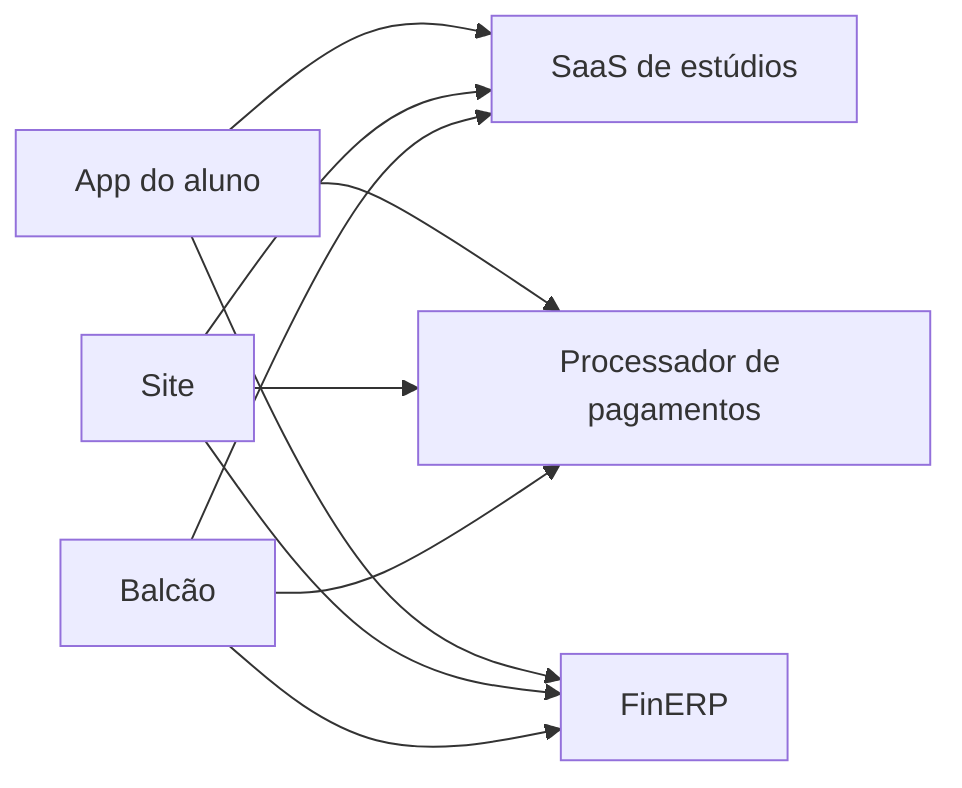
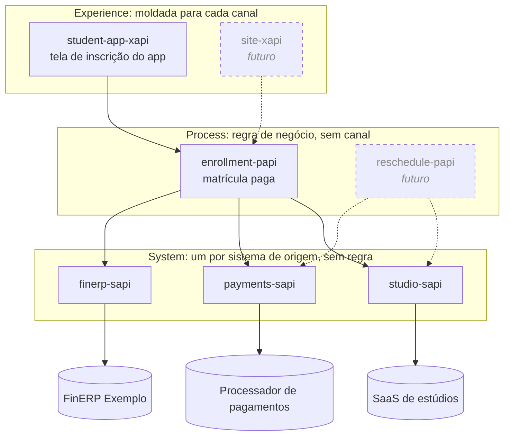
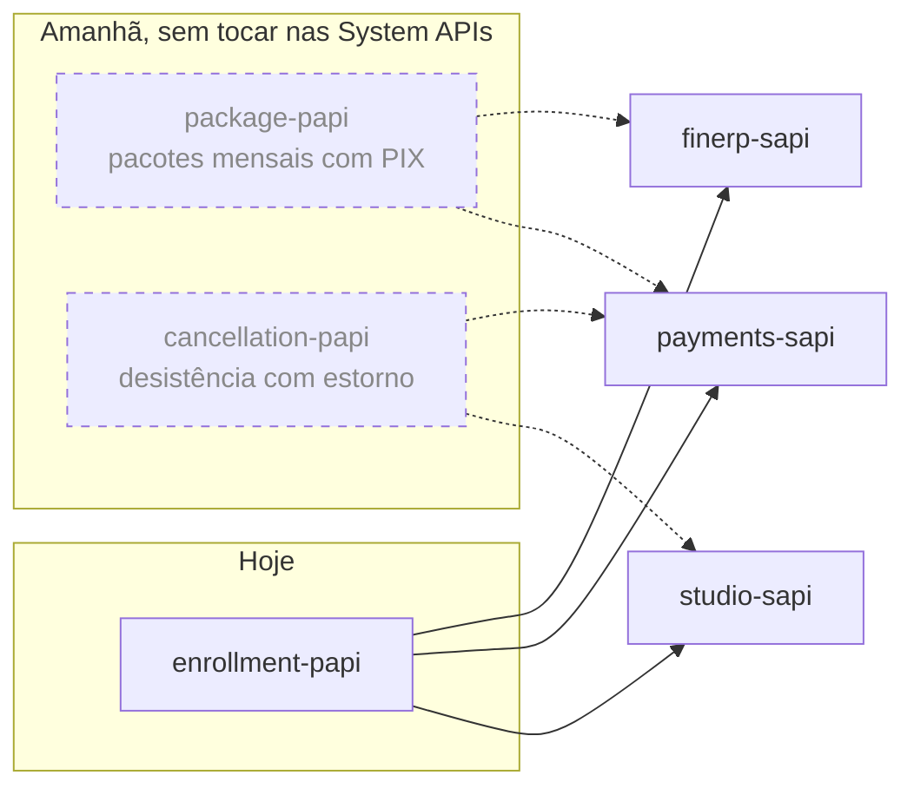
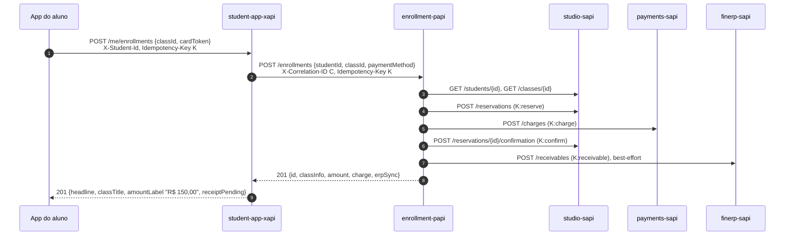

# O padrão API-Led Connectivity neste repositório

Este documento explica o padrão, por que ele tem três camadas, como entrega reuso e como a governança o mantém de pé. Os exemplos são do domínio fictício: uma rede de estúdios de yoga e pilates que matricula alunos pelo app, cobra num processador de pagamentos e registra o título num ERP financeiro (FinERP Exemplo).

## O problema que o padrão resolve

Sem uma arquitetura de integração, cada canal fala direto com cada sistema:

São N canais x M sistemas integrações. A regra "reserva, cobra, confirma e registra" é reimplementada em cada canal, o layout legado do ERP (campos em maiúsculas, centavos como texto, datas `yyyyMMdd`) vaza para todo lugar e trocar o ERP vira um projeto em cada canal.

## As três camadas

| Camada | Responsabilidade | O que **não** faz | Muda quando |
| --- | --- | --- | --- |
| **System** | Traduz o formato nativo para um modelo canônico; protege o sistema (credenciais, retry, timeouts); expõe capacidades do sistema | Regra de negócio, orquestração, formatação para tela | O sistema de origem muda ou é trocado |
| **Process** | Orquestra System APIs numa capacidade de negócio; compensações; regras (elegibilidade) | Conhecer canal, formatar texto para usuário, falar com backend direto | A regra de negócio muda |
| **Experience** | Adapta pedido e resposta a um canal: campos que a tela usa, valores formatados, mensagens prontas | Decidir negócio, chamar System API direto | O canal muda (nova tela, novo app) |

Dependências só descem. Uma Experience API nunca chama uma System API: se a tela precisa de algo, ou a Process API passa a oferecer, ou nasce uma Process API nova. Isso é verificado no design (cada aplicação só tem clientes HTTP para a camada de baixo).

### Por que três e não duas

- **Sem Process:** a orquestração (reservar, cobrar, compensar) iria para cada Experience API. O segundo canal copiaria a saga, e as cópias divergiriam.
- **Sem System:** a Process API conheceria o layout do FinERP e o formato do processador. Trocar o ERP mexeria na regra de matrícula.
- **Sem Experience:** a Process API carregaria textos de tela e formatos de cada canal, e deixaria de ser reutilizável.

O custo é real: mais saltos de rede, mais artefatos para operar e mais contratos para manter. Para um único canal e um único processo, três camadas podem ser excesso. O padrão se paga quando o segundo canal ou o segundo processo chega.

## Reuso na prática

O modelo canônico das System APIs é mais amplo que a necessidade atual. A `payments-sapi` aceita PIX, embora a matrícula só use cartão: quando o processo de pacotes mensais quiser PIX, a System API já está pronta e testada. A `studio-sapi` expõe cancelamento de reserva, usado hoje só como compensação, mas disponível para um futuro processo de desistência.

O que é reaproveitado: contrato, tradução de formato, credenciais, política de retry e o conhecimento de cada sistema legado (por exemplo, que o FinERP responde HTTP 200 com erro em `COD_RETORNO`, ou que o código E023 significa "título já cadastrado" e deve ser tratado como sucesso idempotente).

## Governança: o que mantém as camadas honestas

Reuso depende de previsibilidade. Uma API nova só é reaproveitada se for igual às outras no que importa. Aqui a governança é código e roda no CI:

| Convenção | Por quê | Onde é verificada |
| --- | --- | --- |
| `x-api-layer` e `x-owner-team` em toda spec | Saber a camada e o dono de cada API | `.spectral.yaml` |
| `X-Correlation-ID` em toda operação, propagado pelos requesters e devolvido na resposta | Seguir uma matrícula do app ao ERP nos logs | `.spectral.yaml` + teste de governança |
| `Idempotency-Key` obrigatório em todo POST | Tornar retry seguro em todas as camadas | `.spectral.yaml` |
| Contrato de erro comum (`code`, `message`, `correlationId`) | Consumidores tratam erro do mesmo jeito em qualquer API | `.spectral.yaml` |
| Toda saída HTTP dentro de `until-successful`, só falhas transitórias retentadas | Resiliência sem multiplicar chamadas | Teste de governança |
| Transformações em `.dwl` com MUnit | DataWeave testável e revisável | Teste de governança |
| Todo erro lançado mapeado no catálogo | Nenhum erro vira 500 genérico por esquecimento | Teste de governança |
| Fixtures dos testes validadas contra o schema de quem produz ou consome | Quebra de contrato entre camadas aparece no PR | `tools/contracts.yaml` |
| Mesmas chaves de configuração em todos os ambientes; segredos só cifrados | Sem drift e sem segredo em claro | Teste de governança |

Na Anypoint Platform, parte disso seria feita por API Governance, Exchange e políticas do API Manager. O `api-gateway:autodiscovery` em cada aplicação liga o runtime ao API Manager, onde ficam políticas como client ID enforcement (por isso a Process API envia `client_id`/`client_secret` às System APIs) e rate limiting.

## Como uma requisição atravessa as camadas

O mesmo `X-Correlation-ID` aparece no log JSON de todas as aplicações. A mesma chave de idempotência, derivada por etapa, permite repetir a requisição inteira sem duplicar nada.
