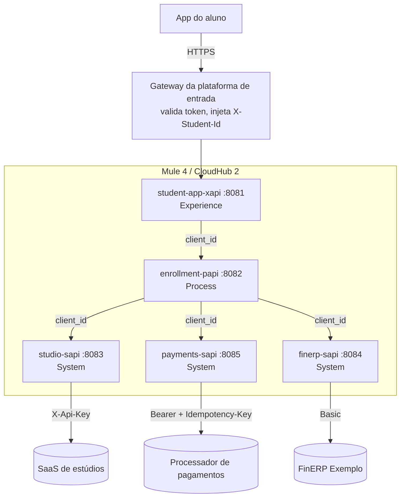
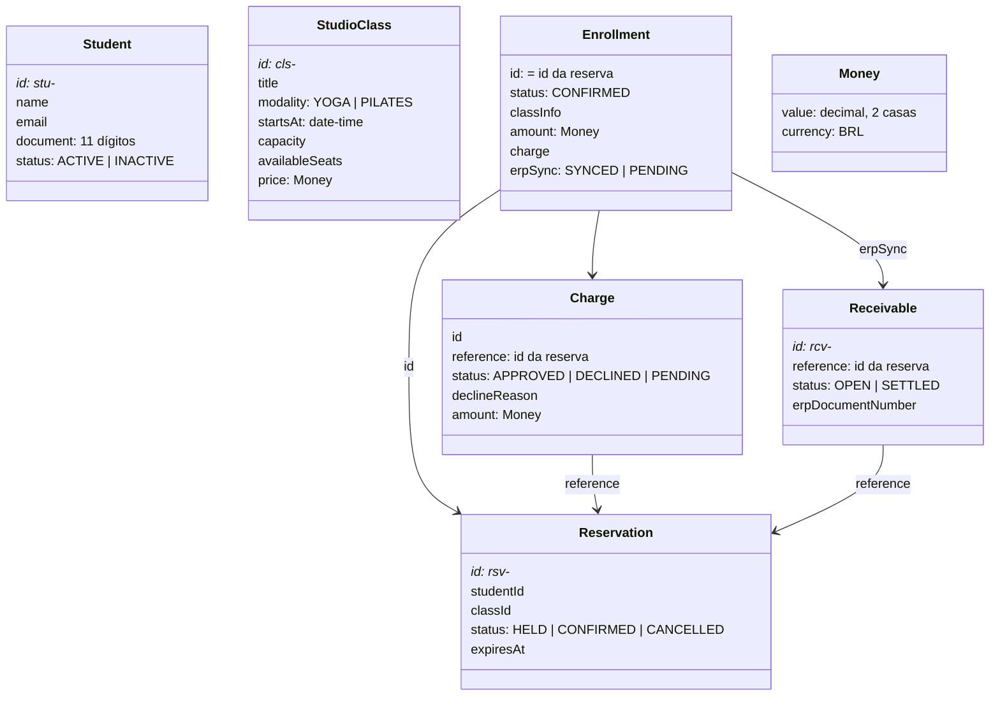
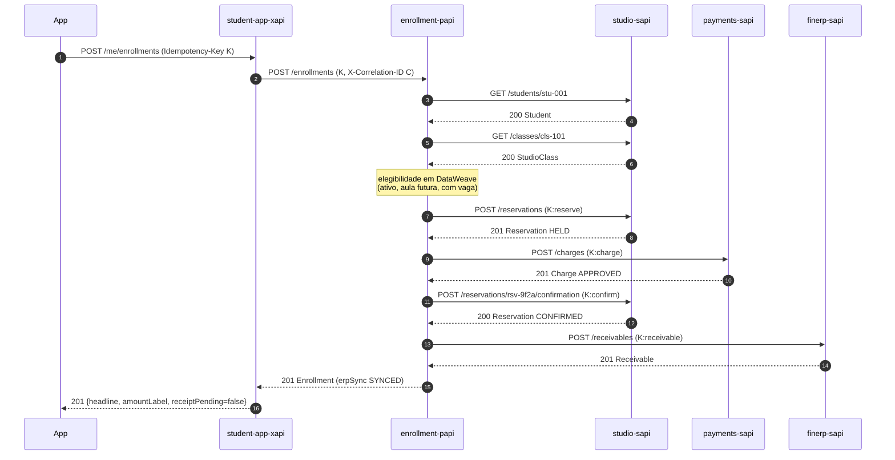
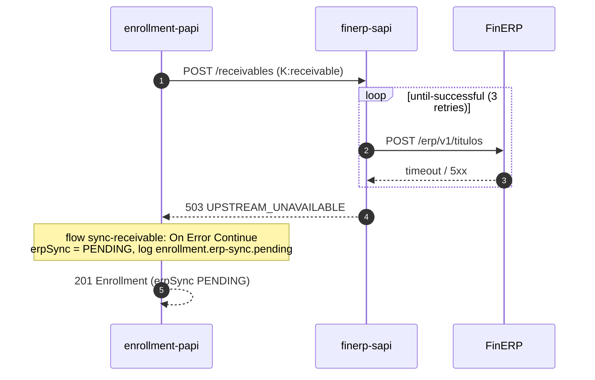

# Design doc: integração API-Led da matrícula paga

- **Status:** fundação implementada
- **Autor:** Johnny Santos
- **Última revisão:** 2026-11-21

## Contexto

Uma rede fictícia de estúdios de yoga e pilates usa três sistemas que não se conhecem:

- **SaaS de estúdios** (projeto 3 do portfólio): alunos ("membros"), aulas ("sessões") e reservas ("bookings"), em JSON snake_case.
- **Processador de pagamentos** (projeto 1 do portfólio): cobranças em centavos, com status próprios e `Idempotency-Key`.
- **FinERP Exemplo**: ERP financeiro legado. Campos em maiúsculas, valores em centavos como texto com zeros à esquerda, datas `yyyyMMdd`, autenticação básica e HTTP 200 até para erro (o resultado vem em `COD_RETORNO`).

Hoje a matrícula é manual: a recepção confere a vaga, cobra na maquininha e lança o título no ERP no fim do dia. O app do aluno precisa fazer isso sozinho, em uma chamada, sem cobrar duas vezes e sem deixar aluno pago sem vaga.

## Objetivos

1. Matrícula paga pelo app em uma requisição síncrona, com resposta pronta para a tela.
2. Arquitetura API-Led em três camadas, com contratos OAS e deploy independente por API.
3. Nenhuma cobrança duplicada em retry, timeout ou reenvio do app.
4. Nenhum aluno cobrado sem vaga e nenhuma vaga presa sem pagamento (com as exceções documentadas em Falhas).
5. ERP fora do ar não impede matrícula.
6. Rastreabilidade de ponta a ponta por `correlationId`.
7. Governança verificável sem a Anypoint Platform: contratos, convenções e configuração checados no CI.

## Não-objetivos (desta fundação)

- Estorno automático, cancelamento e remarcação de matrícula.
- PIX e outros meios assíncronos na matrícula (a System API de pagamentos já aceita PIX).
- Reprocessamento automático de títulos `PENDING` no ERP.
- Deploy real no CloudHub, políticas configuradas no API Manager e publicação no Exchange.
- Autenticação do aluno: o gateway da plataforma de entrada (projeto 4) valida o token e injeta `X-Student-Id`.

## Arquitetura

Cinco aplicações Mule 4.9 independentes, cada uma com spec OAS 3.0, APIkit, configuração por ambiente e handler de erro global. Detalhes do padrão em [api-led.md](api-led.md).



Estrutura de cada aplicação:

| Arquivo | Conteúdo |
| --- | --- |
| `src/main/mule/global.xml` | propriedades por ambiente, secure properties, listener, APIkit, request configs, autodiscovery |
| `src/main/mule/global-error-handler.xml` | handler global (Continue para 4xx, Propagate para 5xx) e montagem da resposta de erro |
| `src/main/mule/<app>.xml` | flow principal (listener + router) e um flow por operação |
| `src/main/mule/*-backend.xml` / `*-client.xml` | única saída HTTP para a camada de baixo, com retry |
| `src/main/resources/dw/*.dwl` | transformações |
| `src/main/resources/modules/*.dwl` | funções reutilizáveis (catálogo de erros, formatação) |
| `src/test/munit/*.xml` | suítes MUnit de transformações e de flows |
| `src/test/resources/fixtures/` | payloads fictícios, também usados pelos mocks e pelos testes de contrato |

## Modelo de dados

O modelo canônico vive nas System APIs e é consumido pela Process API.



A reserva é a âncora: o id da matrícula é o id da reserva, e cobrança e título usam esse id como referência. Isso liga os três sistemas na conciliação sem um banco próprio da integração.

Principais traduções (todas em `.dwl` com MUnit):

| De | Para | Regra |
| --- | --- | --- |
| membro do estúdio | `Student` | documento só com dígitos, e-mail minúsculo, `active` -> `ACTIVE`/`INACTIVE` |
| sessão do estúdio | `StudioClass` | `price_cents / 100`; `availableSeats = max(capacity - booked, 0)` (overbooking manual) |
| booking | `Reservation` | estado desconhecido falha em vez de sair do contrato |
| `ChargeRequest` | pagamento do processador | `round(value * 100)`, descritor em maiúsculas com 22 caracteres |
| pagamento do processador | `Charge` | `authorized`/`captured` -> `APPROVED`; código de recusa desconhecido -> `OTHER`; status desconhecido falha |
| `ReceivableRequest` | título do FinERP | maiúsculas sem acento, limite por campo, centavos com 15 posições, datas `yyyyMMdd` |
| `Enrollment` | tela do app | `R$ 1.250,50` independente do locale da JVM; `receiptPending` |
| erro da Process API | erro do app | mensagem pronta por código, fallback genérico |

## Fluxos principais

### Matrícula com sucesso



### Pagamento recusado (compensação)

```mermaid
sequenceDiagram
    autonumber
    participant P as enrollment-papi
    participant S as studio-sapi
    participant Pay as payments-sapi
    P->>S: POST /reservations (K:reserve)
    S-->>P: 201 HELD
    P->>Pay: POST /charges (K:charge)
    Pay-->>P: 201 Charge DECLINED (processador respondeu 402)
    P->>S: DELETE /reservations/rsv-9f2a
    alt liberou
        S-->>P: 204
    else falhou
        S-->>P: 503
        Note over P: On Error Continue: log enrollment.compensation.failed;<br/>o hold expira sozinho no estúdio
    end
    Note over P: raise ENROLLMENT:PAYMENT_DECLINED -> 422 (On Error Continue global)
```

### ERP indisponível (degradação)



## Falhas e como são tratadas

| Falha | Onde | Tratamento | Resposta |
| --- | --- | --- | --- |
| Backend lento ou 5xx | System API | `until-successful` (3 retries), só falhas transitórias | 503 `UPSTREAM_UNAVAILABLE` se esgotar |
| Backend 4xx | System API | sem retry; vira erro `STUDIO:*`, `PAYMENTS:REJECTED`, `FINERP:REJECTED` | 404/409/422 |
| FinERP 200 com erro | `finerp-sapi` | classifica `COD_RETORNO`; E023 (duplicado) é sucesso idempotente | 201 ou 422 |
| Credencial recusada pelo ERP | `finerp-sapi` | `FINERP:AUTH_FAILED`, propagado, sem detalhes | 502 |
| Cartão recusado (402) | `payments-sapi` | não é erro técnico: `Charge DECLINED` | 201 |
| System API não responde | Process API | 2 retries só de conexão/timeout | 503 |
| System API responde 503 | Process API | sem retry (ela já repetiu) | 503 |
| Aluno inativo / aula iniciada / lotada | Process API | regra em DataWeave antes de qualquer escrita | 422 / 422 / 409 |
| Aula lota entre leitura e reserva | Process API | 409 do estúdio na reserva | 409 `CLASS_FULL` |
| Pagamento recusado | Process API | libera a vaga (best-effort) | 422 `PAYMENT_DECLINED` |
| Pagamento sem resposta | Process API | **não** libera a vaga (resultado desconhecido); cliente repete com a mesma chave | 503 |
| Reserva expirou após cobrar | Process API | log `enrollment.refund.required`, Propagate | 409 `RESERVATION_EXPIRED` |
| ERP indisponível ou rejeitou | Process API | On Error Continue | 201 com `erpSync PENDING` |
| Erro inesperado | qualquer | On Error Propagate `ANY`, sem detalhes internos | 500 |
| App reenvia após timeout | todas | mesma `Idempotency-Key`, chaves derivadas por etapa | mesmo resultado |

Lacunas conhecidas: estorno automático no caso `RESERVATION_EXPIRED`; reprocessamento de `PENDING`; ausência de circuit breaker (um backend fora do ar consome 4 tentativas por requisição).

## Segurança

- **Autenticação do aluno** no gateway (fora deste repositório); a Experience API confia em `X-Student-Id` só porque não é exposta diretamente. O aluno nunca vem do corpo da requisição.
- **Entre camadas:** client ID enforcement do API Manager (`client_id`/`client_secret`), ligado por `api-gateway:autodiscovery`. Em CloudHub 2 o tráfego interno usa o DNS privado do Private Space.
- **Para os backends:** API key (estúdio), Bearer (processador) e Basic preemptivo (FinERP), definidos como headers padrão do request config.
- **Segredos:** só em `config/secure-<env>.yaml`, cifrados (AES/CBC) com chave injetada como propriedade protegida (`secure.key`). Local e mocks usam a chave pública de desenvolvimento `devonly-changeme` e valores `dev-only-*`; dev e prod versionam só o placeholder `![CIFRAR_NO_PIPELINE]`. Os valores locais foram gerados com OpenSSL no modo padrão do módulo e devem ser conferidos com o `secure-properties-tool` na primeira execução real.
- **Validação de entrada** pelo APIkit contra a spec (padrões de id como `^stu-[a-z0-9]+$` evitam path injection ao montar URLs dos backends; `additionalProperties: false` nos pedidos).
- **Vazamento de informação:** 5xx devolvem só código genérico e `correlationId`; detalhes ficam no log.
- **Dados pessoais:** os logs registram ids, não nome, e-mail nem documento.

## Observabilidade

- **Logs estruturados:** `log4j2.xml` com `JsonLayout` (uma linha JSON por evento) incluindo o contexto do runtime, onde está o `correlationId`, e os campos `app` e `layer`. Os loggers dos flows emitem JSON com `event` nomeado (`enrollment.started`, `enrollment.completed`, `enrollment.erp-sync.pending`, `enrollment.refund.required`, `request.rejected`, `request.failed`...).
- **Correlação:** o listener adota o `X-Correlation-ID` recebido (ou gera um), os requesters o enviam sempre (`sendCorrelationId="ALWAYS"`) e toda resposta, inclusive de erro, devolve o header. O mesmo id aparece no corpo de erro.
- **Métricas:** no Mule, métricas de runtime e de API vêm do Anypoint Monitoring (não há endpoint Prometheus nativo). A escolha de Continue para 4xx e Propagate para 5xx (ADR 0006) faz a métrica de eventos com falha refletir só falhas técnicas. Alertas sugeridos: taxa de `request.failed` por API, contagem de `enrollment.refund.required` (deve ser zero) e de `enrollment.erp-sync.pending`.
- **Traces:** o runtime 4.6+ pode exportar spans OpenTelemetry por propriedades de sistema do runtime; a configuração do exporter (endpoint OTLP do Jaeger da plataforma de entrada) entra no deploy, não nos flows. Não foi exercitada nesta fundação.

## Alternativas consideradas

| Alternativa | Por que não |
| --- | --- |
| Integração ponto a ponto | N x M integrações e regra duplicada por canal (ADR 0001) |
| RAML 1.0 | tooling de validação fora do Anypoint parado (ADR 0002) |
| Coreografia por eventos para a matrícula | a tela precisa de resposta síncrona (ADR 0005) |
| Cobrar antes de reservar | risco de cobrar sem vaga |
| Retry em todas as camadas para tudo | multiplica chamadas e repete 4xx inúteis (ADR 0004) |
| Propagate para todos os erros | métricas de falha poluídas por recusas de negócio (ADR 0006) |
| MUnit obrigatório no CI público | exige credencial do repositório EE (ADR 0007) |

## Plano de evolução

1. Executar as suítes MUnit com credencial EE e corrigir o que o runtime apontar; ligar o job manual como obrigatório em um repositório privado.
2. Rodar os `.dwl` isolados no CI com a DataWeave CLI (binário nativo, sem Java), comparando com as fixtures esperadas.
3. Reprocessamento de `erpSync PENDING` por fila (SQS ou Anypoint MQ), com LocalStack no docker-compose e ADR próprio.
4. Estorno automático quando a reserva expira após a cobrança (`payments-sapi` ganha `POST /charges/{id}/refund`).
5. PIX na matrícula: reserva mais longa e confirmação por webhook do processador.
6. Leituras de aluno e aula em paralelo (scatter-gather) e circuit breaker nos backends.
7. Biblioteca comum (catálogo de erros, handler global, log) publicada no Exchange, eliminando a duplicação entre as cinco aplicações.
8. Specs publicadas no Exchange e políticas declaradas como código no API Manager.
